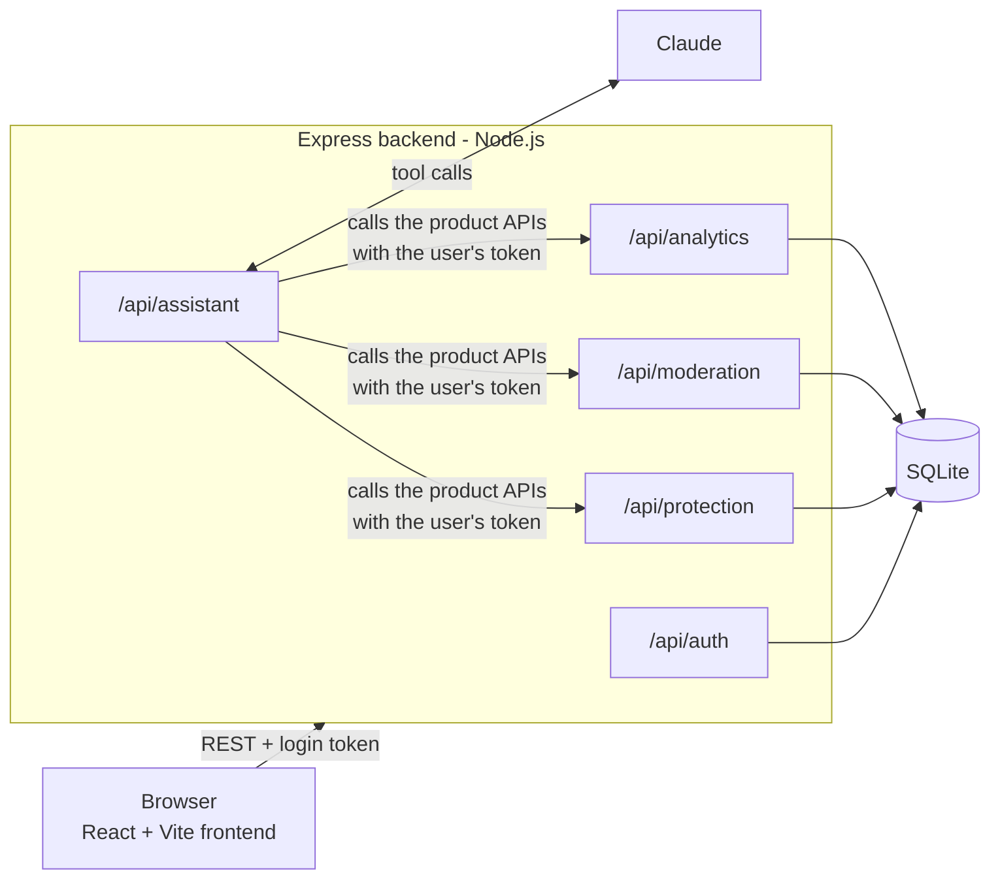
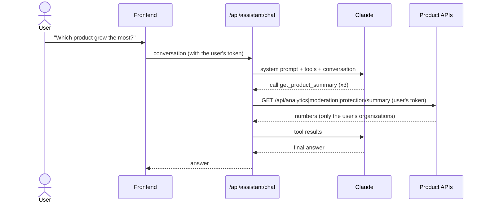
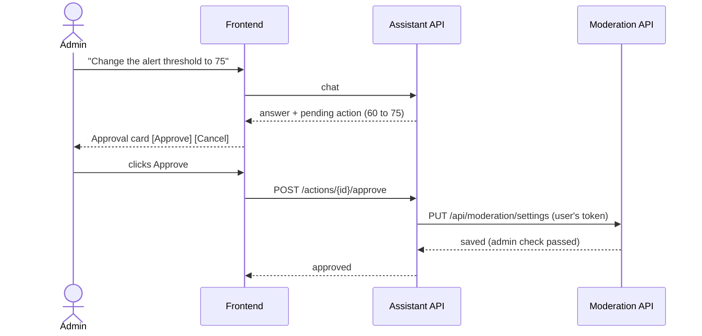

# Architecture



## Parts

| Part | Responsibility |
|---|---|
| **Frontend** (React, Vite, React Router) | Pages, charts and filters. Gets all data from the REST APIs, never from the database. Stores the login token in the browser and sends it with every request. |
| **Backend** (Express on Node.js) | Login, the three product APIs, permission checks and the AI assistant. |
| **Database** (SQLite, built into Node.js as `node:sqlite`) | Organizations, users, memberships, daily product data, the alert threshold and pending assistant actions. Queries are plain SQL with `?` parameters. No database server or native package to install. |
| **Claude** (Anthropic API, `@anthropic-ai/sdk`) | Understands the question and decides which tools to call. |

Both halves are TypeScript, in one npm workspace: `npm install` and `npm run dev` at the top level handle both.

## Product APIs

Each product has its own API (own URL prefix and code file in `backend/src/routes/`). The parts that are identical for all three (filters, date range, % change, the summary and timeseries endpoints) live in `routes/productApi.ts`; each product file declares its own table and numbers. All accept `org`, `start` and `end` filters.

| Endpoint | Returns |
|---|---|
| `GET /api/{product}/summary` | Totals for the period. Also the previous period of the same length and the % change, which the AI assistant uses to compare products. |
| `GET /api/{product}/timeseries` | Numbers per day |
| `GET /api/moderation/settings?org=` | Current alert threshold, and whether the user may change it |
| `PUT /api/moderation/settings?org=` | Change the threshold (admins of that organization only) |

Other endpoints: `POST /api/auth/login`, `GET /api/auth/me`, `POST /api/assistant/chat`, `POST /api/assistant/actions/{id}/approve`, `POST /api/assistant/actions/{id}/reject`, `GET /api/health`.

Input is checked with **zod**. Errors come back as JSON in the form `{"detail": "..."}` with a fitting status code (401 not signed in, 403 no access, 404, 409 already decided, 422 bad input).

## Tenant isolation and roles

- A user reaches an organization only through a **membership**, which stores their role there (`admin` or `standard`).
- Every protected endpoint runs the `requireUser` middleware (`backend/src/auth.ts`), which reads the user and their memberships from the login token.
- `allowedOrgs()` decides which organizations a request may read: no `org` means all of the user's organizations; any other organization returns **403**. Every database query is filtered to those organizations.
- `requireAdmin()` allows settings changes only for admins of that specific organization.
- These checks run on the server for every request, so they apply no matter what the frontend or the assistant sends.

## How the AI assistant works



1. The frontend sends the conversation to `/api/assistant/chat`.
2. The backend sends Claude a system prompt (today's date, the user's name, organizations and roles, and rules such as "only use numbers from the tools") together with three tools.
3. Claude decides which tools to call. The backend runs them. **Each tool calls the product REST APIs with the user's own token** (`backend/src/agent/tools.ts`), so the assistant has exactly the user's permissions and never reads the database for product data. The requests go through the full Express app (routing, auth and permission checks), served on a private port on `127.0.0.1` (`agent/callApi.ts`).
4. The results go back to Claude, which writes the answer. Steps 3–4 repeat until Claude is done (at most 8 rounds).

| Tool | What it does |
|---|---|
| `get_product_summary` | Calls `GET /api/{product}/summary` |
| `get_product_timeseries` | Calls `GET /api/{product}/timeseries` |
| `propose_threshold_change` | Calls `GET /api/moderation/settings` to check access and the current value, then saves a **pending action**. It does not change anything. |

### Changing a setting needs approval



- Claude has **no tool that changes a setting**. It can only create a proposal.
- The change runs only when the user clicks **Approve**, which calls the approve endpoint. That endpoint calls the settings API with the user's token, so the admin check runs again at that moment.
- A proposal can be approved only by the user who received it, and only once. Cancel marks it rejected.
- Standard users are refused when the assistant tries to propose a change.

## Sample data

All demo data is in **`backend/data/sample-data.json`**: 2 organizations, 5 users (the file holds names, emails and roles; every account gets the demo password) and 90 days of numbers per organization and product, with weekly patterns and a few built-in trends. `backend/src/seed.ts` checks the file against a schema (zod) and loads it into SQLite the first time the backend starts, or on `npm run reset-db`. Nothing is generated at runtime, so the data is identical on every machine. The product APIs read only from the database, never from the file.

## Folder structure

```
package.json         one workspace for both halves: npm install / dev / test / lint
backend/src/
  server.ts          starts the API, first-start seeding
  app.ts             Express app: CORS, JSON, routes, error handling
  config.ts          settings from .env
  db.ts              SQLite connection and tables
  seed.ts            loads the sample data file (reset-db.ts reloads it)
  auth.ts            passwords, tokens, permission checks
  errors.ts          HttpError, input checks, JSON error responses
  dates.ts           small date helpers
  routes/            auth, analytics, moderation, protection, assistant, shared productApi
  agent/tools.ts     the assistant's tools (call the product APIs)
  agent/callApi.ts   calls our own APIs as the user
  agent/agent.ts     system prompt and the Claude tool-calling loop
backend/data/sample-data.json   all demo data
backend/tests/       Vitest + Supertest tests

frontend/src/
  main.tsx, App.tsx  entry point and page routes (React Router)
  Layout.tsx         page frame; sends signed-out users to /login
  lib/               API client, login state, data-loading hook
  components/        sidebar, filters, stat card, charts, approval card, loading/error states
  pages/             login, dashboard, analytics, moderation, protection, assistant
frontend/tests/      Vitest + Testing Library tests
```

## Trade-offs

- **One backend server for the three product APIs.** Each product has its own API and code file; running them in one process keeps the demo to a single command. They could be deployed separately without changing the frontend.
- **SQLite with plain SQL** keeps setup to zero and the queries easy to read. Moving to PostgreSQL would mean swapping the driver and adjusting a few SQL details.
- **The backend runs TypeScript directly with `tsx`**, so there is no build step for the demo. For production you would compile it first.
- **Token in `localStorage`** keeps the frontend simple. For production, an httpOnly cookie would protect the token better.
